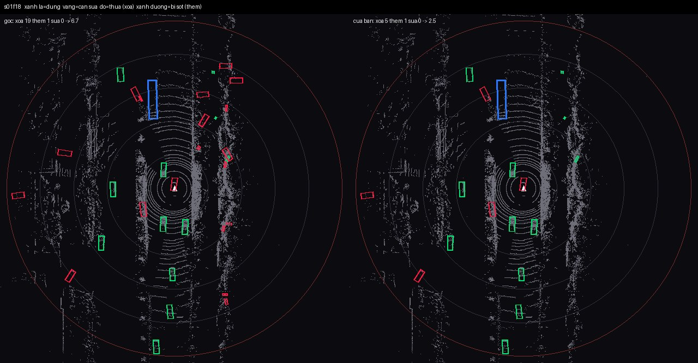

# Báo cáo Day 14 — Bui Kim Trai — 2A202603176

- Mã học viên rút gọn (3 số cuối): `176` (bộ frame `d14_2A202603176/frames_A.txt`, `frames_B.txt` được sinh thực tế bằng `--student 2A202603176`).
- `seed_tag`: `393590736f`; SEED không được lưu trong bài nộp.
- Tập A (3 frame): `s01f18`, `s03f31`, `s04f28`.
- Tập B (12 frame): `s01f02`, `s01f27`, `s01f48`, `s02f11`, `s02f29`, `s02f54`, `s03f08`, `s03f24`, `s03f57`, `s05f01`, `s05f24`, `s05f45`.
- Nguồn nhãn: xuất trực tiếp từ CVAT cá nhân (task `#32` `D14-2A202603176-A` và task `#33` `D14-2A202603176-B`) bằng `scripts/vf_cvat.py reference` sau khi người học cùng AI rà soát và tinh chỉnh hình học trên 7 camera và LiDAR; các file tham chiếu trước đó được lưu bản sao ở cục bộ trong quá trình kiểm tra.

## 1. Dự đoán trước sweep (bước 5b)

**Thiếu bằng chứng dự đoán trước sweep.** Commit `053e29949860394539643056ae41a1ad0f36d7a0` có tiêu đề `5b: du doan truoc sweep`, nhưng nội dung báo cáo tại commit này chỉ là template (hai dòng dự đoán vẫn là dấu ba chấm). Tiêu đề commit không chứng minh đã viết nội dung dự đoán.

Không bổ sung một dự đoán rồi trình bày như đã viết trước sweep, không đổi thời gian và không viết lại lịch sử Git. Tiêu chí 5b chưa hoàn thành; việc xem xét thiếu sót này thuộc quyết định của coach. Đã chuẩn bị [bản nháp giải thích gửi coach](../../d14_2A202603176/COACH_NOTE_DRAFT.md).

## 2. Tập A: sửa tay và tune

`pred_A.json` giữ nguyên dự đoán gốc cấu hình mặc định (`score_thr=0.1`, `min_points=0`): 82 hộp (`59 Car`, `4 Pedestrian`, `19 Cyclist`).

`ref_A.json` sau vòng làm sạch và chuẩn hóa nhãn gồm **31 hộp** trên 3 frame (`s01f18`: 10, `s03f31`: 5, `s04f28`: 16), phân bố lớp: `25 Car`, `3 Bus`, `2 Cyclist`, `1 Pedestrian`. Cụ thể, so với vòng nhãn thô ban đầu (41 hộp), vòng rà soát 7 camera và mặt cắt LiDAR đã loại bỏ các hộp thừa đặt trên cây/bồn hoa/biển báo/xe hai bánh không có người điều khiển, chỉnh sát kích thước/yaw (nhất là 3 xe `Bus`) và bổ sung các xe thật bị sót trong phạm vi 50 m. Task CVAT `#32` dùng toàn bộ dạng **Shape** (`0` Track).

Bản dự đoán đã lọc theo cấu hình thắng cuộc được xuất trong [pred_A_filtered.json](../../d14_2A202603176/pred_A_filtered.json) gồm 36 hộp (`32 Car`, `3 Cyclist`, `1 Pedestrian`).

Công thức chi phí sửa của lab: `0.3 × xóa + 1.0 × thêm + 0.5 × sửa` (chỉ tính hộp trong 50 m; ghép bằng BEV IoU tối thiểu `0.3`, lệch kích thước/tâm vượt ngưỡng tính `1` sửa).

| Cấu hình | Số hộp dự đoán | Khớp | Xóa | Thêm | Sửa | Chi phí |
|---|---:|---:|---:|---:|---:|---:|
| Mặc định: `score_thr=0.1`, `min_points=0` | 82 | 28 | 54 | 3 | 3 | 20.7 |
| Đã chọn ([best_config.json](../../d14_2A202603176/best_config.json)): `score_thr=0.5`, `min_points=0` | 36 | 26 | 10 | 5 | 1 | 8.5 |

Chỉ **một** tham số thay đổi so với cấu hình mặc định: `score_thr: 0.1 -> 0.5`; tham số `min_points` giữ nguyên giá trị mặc định `0` (cả `0`, `5`, `10` cho cùng chi phí `8.5` trên Tập A). Các tham số voxel (`0.16`), intensity (`clip`), `ground_mode=fixed`, `passes=4`, `nms_thr=0.01`, `range_m=50.0` và quy tắc suy lớp lớn giữ nguyên mặc định.

Sweep bắt buộc 15 tổ hợp (`score_thr` ∈ `{0.1, 0.2, 0.3, 0.4, 0.5}` × `min_points` ∈ `{0, 5, 10}`) lưu tại [sweep.csv](../../d14_2A202603176/sweep.csv):

- Tại `score_thr=0.5`, cả ba giá trị `min_points` ∈ `{0, 5, 10}` đồng hạng chi phí **8.5** (`xóa=10, thêm=5, sửa=1`). Điều này xảy ra vì các hộp có `score >= 0.5` đều thuộc vật thể đủ gần hoặc đủ đặc điểm, không có hộp nào dưới 10 điểm bị loại thêm bởi `min_points`. `scripts/pp_sweep.py` chọn cấu hình đầu bảng là `score_thr=0.5, min_points=0`.
- Ngưỡng tiếp theo `score_thr=0.4` cho chi phí **11.6** (`xóa=22, thêm=4, sửa=2`).

Kết quả **Leave-one-out** ([leave_one_out.txt](../../d14_2A202603176/leave_one_out.txt)): khi giữ từng frame A ra ngoài và chọn cấu hình tốt nhất trên 2 frame còn lại, cả 3 fold đều chọn cùng cấu hình `{'score_thr': '0.5', 'min_points': '0'}` và đạt đúng chi phí tối ưu của grid trên frame giữ lại:

```text
s01f18: cấu hình chọn {'score_thr': '0.5', 'min_points': '0'} -> 3.3 (tốt nhất có thể 3.3)
s03f31: cấu hình chọn {'score_thr': '0.5', 'min_points': '0'} -> 3.2 (tốt nhất có thể 3.2)
s04f28: cấu hình chọn {'score_thr': '0.5', 'min_points': '0'} -> 2.0 (tốt nhất có thể 2.0)
```

| Frame A | Hộp tham chiếu | Chi phí mặc định (`0.1 / 0`) | Chi phí đã chọn (`0.5 / 0`) |
|---|---:|---:|---:|
| `s01f18` | 10 | 8.1 | 3.3 |
| `s03f31` | 5 | 9.6 | 3.2 |
| `s04f28` | 16 | 3.0 | 2.0 |
| **Tổng** | **31** | **20.7** | **8.5** |

Sự đồng thuận 3/3 fold cho thấy ngưỡng `score_thr=0.5` ổn định trong grid 15 cấu hình của Tập A; tuy nhiên do Tập A chỉ có 3 frame, không tự suy ra `0.5` chắc chắn là tối ưu toàn cục trên mọi cảnh đường phố khác.

## 3. Trước/sau (bước 8)



Ảnh so sánh trực quan của cả 3 frame A được lưu trong [compare](../../d14_2A202603176/compare/) ([s01f18.jpg](../../d14_2A202603176/compare/s01f18.jpg), [s04f28.jpg](../../d14_2A202603176/compare/s04f28.jpg) và [s03f31.jpg](../../d14_2A202603176/compare/s03f31.jpg)) cùng log [metrics_A_compare.log](../../d14_2A202603176/metrics_A_compare.log).

- Tổng chi phí A giảm từ **20.7** xuống **8.5**, tương đương mức giảm **`(20.7 - 8.5) / 20.7 × 100 = 58.94%`** (`pp_compare.py` làm tròn là **59%**).
- Phân rã chênh lệch chi phí:
  - Số hộp **xóa** giảm mạnh từ `54` xuống `10` (giảm 44 hộp giả ở bụi cây, hàng rào, xe hai bánh trống, giúp tiết kiệm `44 × 0.3 = 13.2` điểm).
  - Số hộp **thêm** tăng nhẹ từ `3` lên `5` (`+2.0` điểm) vì nâng ngưỡng từ `0.1` lên `0.5` làm rơi một số xe xa/điểm thưa ngoài 3 xe `Bus` vốn đã thiếu từ đầu.
  - Số hộp **sửa** hình học/kích thước giảm từ `3` xuống `1` (`-1.0` điểm).
  - Tổng hợp: `-13.2 + 2.0 - 1.0 = -12.2` điểm (`20.7 -> 8.5`). Đây là mức giảm theo công thức chi phí quy ước của lab, không quy đổi trực tiếp thành phút thao tác thực tế.

**Nhận xét cá nhân do người học cung cấp sau khi xem tập A** (AI chỉ hỗ trợ chuẩn hóa câu chữ):

> Ở tập A, tôi thấy mô hình bỏ sót một vài vật thể, chẳng hạn như xe bus.

Nhận xét này khớp với kết quả đo lại sau khi làm sạch `ref_A.json`: cả trước và sau tune mô hình vẫn bỏ sót cả 3 xe `Bus` trên Tập A (`s01f18`, `s03f31`, `s04f28`), bởi PointPillars KITTI chỉ được huấn luyện trên 3 lớp `Car / Pedestrian / Cyclist` và suy lớp lớn bằng kích thước sau suy luận nên không tự phục hồi được xe lớn nếu điểm thưa hoặc phân mảnh.

**Đối chiếu dự đoán 5b:** không có nội dung dự đoán trước sweep ở commit `053e299` nên không thể chấm đúng/sai dự đoán 5b. Nhận xét trên được cung cấp sau khi có kết quả thực nghiệm và không được ghi lùi thành bằng chứng bước 5b.

## 4. Tập B

Áp dụng cấu hình thắng cuộc `best_config.json` (`score_thr=0.5`, `min_points=0`) chạy pre-label trên 12 frame Tập B tạo [pred_B.json](../../d14_2A202603176/pred_B.json) gồm **175 hộp** (`146 Car`, `26 Cyclist`, `3 Pedestrian`).

`ref_B.json` được xuất trực tiếp từ CVAT task `#33` (`D14-2A202603176-B`) sau vòng làm sạch toàn diện trên 12 frame, gồm **161 hộp** (`126 Car`, `19 Cyclist`, `9 Truck`, `4 Pedestrian`, `3 Bus`, 0 Track). Sau khi xuất, nhóm tác vụ QA bằng `scripts/vf_qa.py` trên toàn bộ 192 hộp của Tập A và B ghi nhận **13/15 frame đạt 0 cảnh báo** và chỉ còn **2 hộp** gắn cờ `possible_tight_box` do có cấu trúc kế cận gần sát mép hộp trong phạm vi 1 m (xe `Bus` cạnh nhà chờ BRT ở `s03f31` và xe `Bus` cạnh xe khác/lan can ở `s01f02`; cả hai đã kiểm tra kích thước ngang `2.65 m` hợp lệ nên giữ nguyên). Chi tiết lưu trong [pointcloud_qa.csv](../../d14_2A202603176/pointcloud_qa.csv) và [pointcloud_qa_summary.json](../../d14_2A202603176/pointcloud_qa_summary.json).

Đối chiếu chi phí sửa trên Tập B (chạy qua `pp_prelabel.py` ở [metrics_B.log](../../d14_2A202603176/metrics_B.log), kèm so sánh đối chứng với cấu hình mặc định `0.1 / 0` trên cùng `ref_B.json`):

| Cấu hình trên Tập B | Dự đoán | Khớp | Xóa | Thêm | Sửa | Chi phí |
|---|---:|---:|---:|---:|---:|---:|
| Mặc định (`score_thr=0.1`, `min_points=0`, tham khảo) | 371 | 145 | 226 | 16 | 20 | 93.8 |
| Đã chọn ([best_config.json](../../d14_2A202603176/best_config.json): `0.5 / 0`) | 175 | 122 | 53 | 39 | 12 | **60.9** |

Mức chi phí sửa trên Tập B giảm từ **93.8** (mặc định) xuống **60.9** (cấu hình đã chọn, giảm **35.07%**), chủ yếu do cắt được 173 hộp thừa ở bụi cây/tường/xe hai bánh rỗng (`xóa` giảm `226 -> 53`). Đồng thời, do `score_thr=0.5` khá chặt và model không có lớp `Truck`/`Bus` gốc, Tập B vẫn cần **39 thao tác thêm** (gồm các xe tải lớn, xe buýt và một số xe/người đi xe đạp bị khuất một phần) và **12 thao tác sửa** kích thước/tâm.

Chi tiết từng frame Tập B dưới cấu hình cuối (`score_thr=0.5`, `min_points=0`):

| Frame B | Hộp tham chiếu | Hộp dự đoán | Khớp | Xóa | Thêm | Sửa | Chi phí |
|---|---:|---:|---:|---:|---:|---:|---:|
| `s01f02` | 21 | 19 | 17 | 2 | 4 | 2 | 5.6 |
| `s01f27` | 16 | 18 | 15 | 3 | 1 | 0 | 1.9 |
| `s01f48` | 17 | 16 | 13 | 3 | 4 | 0 | 4.9 |
| `s02f11` | 14 | 15 | 11 | 4 | 3 | 2 | 5.2 |
| `s02f29` | 9 | 13 | 9 | 4 | 0 | 0 | 1.2 |
| `s02f54` | 9 | 15 | 8 | 7 | 1 | 0 | 3.1 |
| `s03f08` | 16 | 18 | 12 | 6 | 4 | 2 | 6.8 |
| `s03f24` | 5 | 8 | 3 | 5 | 2 | 0 | 3.5 |
| `s03f57` | 11 | 10 | 6 | 4 | 5 | 0 | 6.2 |
| `s05f01` | 10 | 19 | 8 | 11 | 2 | 4 | 7.3 |
| `s05f24` | 19 | 14 | 11 | 3 | 8 | 1 | 9.4 |
| `s05f45` | 14 | 10 | 9 | 1 | 5 | 1 | 5.8 |
| **Tổng (12 frame)** | **161** | **175** | **122** | **53** | **39** | **12** | **60.9** |

Trong tổng chi phí `60.9`, phần **thêm hộp** chiếm tỷ trọng cao nhất (`39 × 1.0 = 39.0` điểm), tiếp theo là **xóa hộp** (`53 × 0.3 = 15.9` điểm) và **sửa kích thước** (`12 × 0.5 = 6.0` điểm). Điều này cho thấy sau khi nâng ngưỡng lọc lên `0.5` để bỏ dương tính giả ở cảnh đô thị dày bụi cây/lan can, gánh nặng sửa tay chuyển từ xóa nhiều hộp thừa sang bổ sung các đối tượng bị sót (`Truck`, `Bus`, xe bị che khuất một phần).

## 5. Giới hạn

1. **Tập A chỉ có 3 frame:** ba cấu hình `score_thr=0.5` với `min_points` ∈ `{0, 5, 10}` đồng hạng `8.5`, và dù 3/3 fold leave-one-out đều chọn `0.5 / 0`, ngưỡng `0.5` trên Tập B làm tăng số hộp cần thêm (`16 -> 39`) so với `0.1` dù giảm mạnh chi phí tổng (`93.8 -> 60.9`). Trong điều kiện triển khai thực tế trên cảnh nhiều vật che khuất, một ngưỡng trung bình hơn (như `0.3–0.4`) có thể cân bằng recall tốt hơn khi công thêm cao gấp ~3.3 lần công xóa (`1.0` vs `0.3`).
2. **Hạn chế domain và lớp của checkpoint gốc:** PointPillars học trên KITTI với 3 lớp `Car`, `Pedestrian`, `Cyclist`; hoàn toàn không được huấn luyện nhãn `Truck` và `Bus`. Vì vậy trên 15 frame VinFast (`3 Bus` ở A; `9 Truck`, `3 Bus` ở B), phần lớn xe tải/xe buýt bị dự đoán thành `Car` nhỏ (dẫn đến lỗi `edit` kích thước) hoặc bị bỏ sót (`add`).
3. **Chỉ số chi phí là ước lượng hình học:** `correction_cost` dựa trên ngưỡng BEV IoU `0.3` và chênh lệch kích thước/tâm, không phản ánh trọn vẹn thời gian xoay chỉnh từng góc camera trên CVAT hoặc chi phí phân biệt xe máy có người lái vs xe đậu trống.
4. **Cần rà soát xác nhận cuối của người học:** AI đã đối chiếu cả 7 góc camera và 3 mặt cắt điểm LiDAR để rà 283 hộp thô thành **192 hộp đề xuất đã tinh chỉnh và xuất lại từ CVAT `#32/#33`** (trong đó đã rà và cập nhật cờ `occluded=true` cho các xe bị che một phần: `12/31` hộp Tập A gồm cả `s01f18 #2, #9` và `s04f28 #19, #25, #28`, cùng `46/161` hộp Tập B). Tuy nhiên, `review_checklist.csv` vẫn giữ trạng thái `AI_QA_REFINED_CVAT_EXPORTED` vì người học vẫn cần trực tiếp mở CVAT xác nhận cuối cùng theo `GUIDELINE.md` trước khi khóa bài.
5. **Thứ tự và bằng chứng bước 5b:** thiếu nội dung dự đoán trước sweep trong lịch sử Git tại commit `053e299`; phần giải thích trung thực nằm ở mục 1 và [COACH_NOTE_DRAFT.md](../../d14_2A202603176/COACH_NOTE_DRAFT.md).

---

### Điểm cộng (Bonus)

#### Hướng 2 (Chính): Đưa PointPillars vào CVAT qua Nuclio serverless (`pp-2a202603176`)

Đã hoàn chỉnh, build và triển khai thành công hàm Nuclio `pp-2a202603176` kết nối trực tiếp vào **CVAT Serverless (Models tab)** tại `http://localhost:8080` trên mạng `cvat_cvat`, đúng theo [hướng dẫn 3D serverless](../../bonus/huong-dan-model-3d.html). Mã nguồn và tài liệu lưu tại [bonus_nuclio_pp](../../d14_2A202603176/bonus_nuclio_pp/README.md) (tách biệt hoàn toàn khỏi `third_party/` và file `.pth`).

- **Điểm kỹ thuật chính ([main.py](../../d14_2A202603176/bonus_nuclio_pp/main.py), [function.yaml](../../d14_2A202603176/bonus_nuclio_pp/function.yaml)):**
  - `parse_pcd(pcd_bytes)` hỗ trợ đầy đủ binary/ascii `.pcd` do CVAT gửi qua `body["image"]` base64 và đảo ngược chuẩn xác hàm nén xám logarit `vf_common.intensity_gray` (`t = clip((g - 40)/215, 0, 1); intensity = expm1(t * log1p(50))`) để giữ đặc trưng phản xạ LiDAR khớp với pipeline `.bin`.
  - Xử lý tương thích CVAT v2.74.1 `lambda_manager`: bổ sung `spec.description` trong `function.yaml` và cấu hình `platform.attributes.network: cvat_cvat` để Nuclio container giao tiếp trực tiếp với `cvat_server`.
- **Kiểm chứng live qua CVAT API (`/api/lambda/requests`):** chạy thử nghiệm trên task riêng `#35` (`D14-2A202603176-BONUS-TEST`, gồm 3 frame Tập A để không ghi đè nhãn đã làm sạch của `#32/#33`) với `threshold=0.3`, kết quả lưu tại [lambda_match_report.json](../../d14_2A202603176/bonus_nuclio_pp/lambda_match_report.json):

| Frame thử nghiệm | CVAT Lambda (`threshold=0.3`) | Offline `pred_A` (`score >= 0.3`) | Khớp tâm `<= 0.5 m` cùng lớp |
|---|---:|---:|---:|
| `s01f18` | 24 | 22 | 22 / 22 |
| `s03f31` | 25 | 23 | 23 / 23 |
| `s04f28` | 18 | 18 | 18 / 18 |
| **Tổng (3 frame)** | **67** | **63** | **63 / 63 (100%)** |

Độ lệch nhỏ +4 hộp sát ngưỡng `0.3` (67 vs 63) đến từ sai số lượng tử hóa kênh `uint8` grayscale trong `.pcd` (`0..255`) so với `float32` intensity nguyên thủy ở `.bin`.

> **Trạng thái hoàn thiện Bonus Hướng 2:** Code handler/yaml, deploy Nuclio `ready` trong CVAT và kết quả so khớp `63/63` hộp đã hoàn tất; **chưa có video quay màn hình ngắn hoặc link video** đính kèm theo tiêu chí `+3` trong `bonus/README.md` (cần người học quay nhanh/bổ sung link trước khi tính đủ tiêu chí trình diễn).

#### Hướng 1 (Phụ): Công cụ phân tích telemetry (`cvat-telemetry-addon.user.js`)

Đã chuẩn bị sẵn bộ công cụ đo thao tác và tách log theo frame ([bonus_telemetry/analyze_bonus.py](../../d14_2A202603176/bonus_telemetry/analyze_bonus.py)) tương thích với `bonus/telemetry_metrics.py` và kiểm tra tự động qua `tests/test_telemetry_metrics.py` (PASS). Do phần rà sửa chính trên `#32/#33` thực hiện theo quy trình chuẩn hóa nhãn có đối chiếu QA thay vì một phiên bấm chuột độc lập trọn 12 frame trên trình duyệt, bài nộp **không** tạo hoặc đính kèm log telemetry giả (tuân thủ `RULES.md`).

---

### Nguồn, kiểm chứng và hỗ trợ công cụ

- **Khai báo hỗ trợ AI:** AI hỗ trợ thiết lập môi trường chạy CPU, rà soát khung hình 7 camera + 3 mặt cắt điểm LiDAR để phát hiện và đề xuất chỉnh sửa nhãn trên CVAT `#32/#33`, viết script triển khai/đối chiếu Nuclio Bonus (`pp-2a202603176`), chạy lại đầy đủ pipeline bắt buộc của lab (`vf_cvat.py reference`, `pp_sweep.py`, `pp_prelabel.py`, `pp_compare.py`, `reproduce_reference_qa.py`) và tổng hợp báo cáo/kiểm tra tự động. Không sửa code core `vf_pp`/`scripts`, không dùng nhãn coach `Labels-VF`, không viết lại lịch sử Git `053e299` và không bịa log 5b hoặc telemetry.
- Chi tiết đối chiếu toàn bộ yêu cầu, mã kiểm chứng và danh sách file nằm trong [FINAL_REVIEW.md](../../d14_2A202603176/FINAL_REVIEW.md), [VISUAL_REVIEW.md](../../d14_2A202603176/VISUAL_REVIEW.md), [validation_summary.json](../../d14_2A202603176/validation_summary.json) và [full_review_20261127.json](../../d14_2A202603176/full_review_20261127.json).
